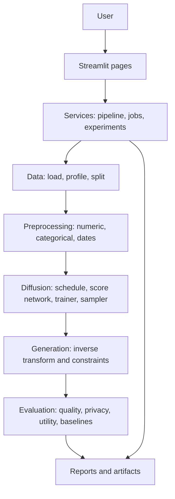
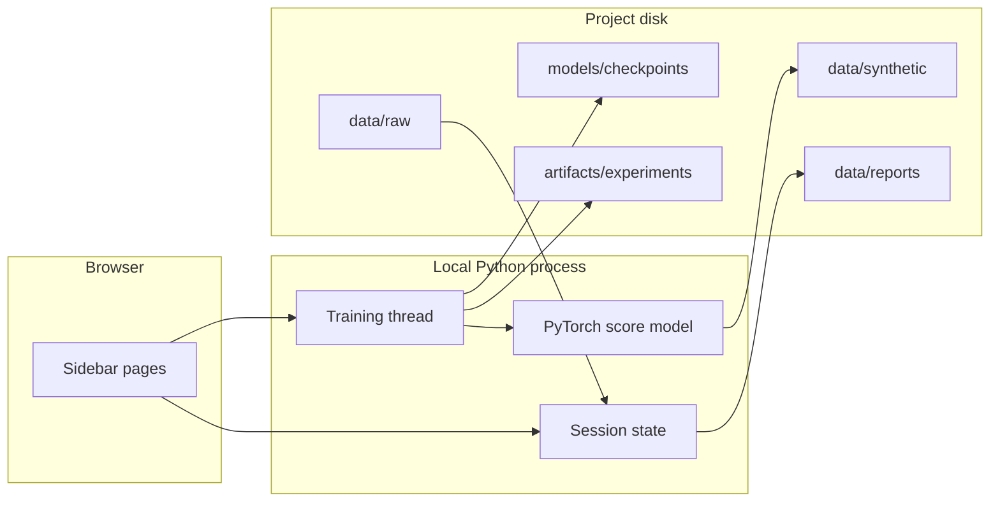
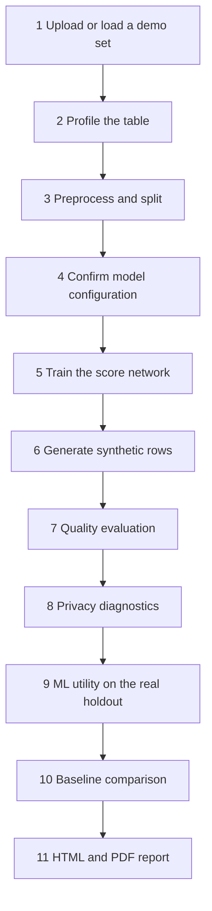
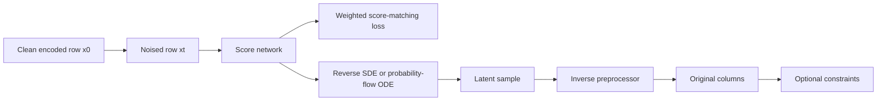

# TabDiffuse: Architecture and Process

Score-based diffusion for privacy-aware synthetic tabular data. This document describes the system as it is implemented: the problem it answers, the architecture, the user process, the mathematics, the files each run writes, and the limits of the measurements.

TabDiffuse runs locally. Uploaded tables are not sent to an external service. Synthetic rows are not treated as automatically private.

## 1. Problem and objectives

Sharing or training on raw tabular records exposes the people or organizations those rows describe. Copying rows, or adding simple noise, does not measure the trade-off between usefulness and disclosure. TabDiffuse learns a score function for a mixed-type table, draws new rows, restores the original columns, and then measures statistical similarity, empirical privacy risk, and downstream machine-learning utility as three separate results.

### Research questions

1. Can a score-based diffusion model generate synthetic tabular rows that preserve statistical characteristics of the real table?
2. How do synthetic feature distributions and correlations compare with the real table?
3. Can the synthetic rows serve as useful training data for a downstream model tested on held-out real rows?
4. What empirical privacy risks remain in the generated records?
5. How does TabDiffuse compare with random resampling, an independent Gaussian, and a Gaussian copula?

### What the system does not claim

- A privacy label is not differential privacy, k-anonymity, or a guarantee that a person cannot be recognized.
- A falling training loss is not proof that decoded ages, incomes, or dates sit on the original scale.
- Quality, privacy, and utility can disagree. A method can copy the table (high similarity, 100% exact matches) or wander far from it (low similarity, large distances).

## 2. System architecture

The interface is separate from the learning code. Streamlit pages call a service layer. The service layer calls data, preprocessing, diffusion, generation, evaluation, and reporting modules. A headless script, `python -m src.demo_pipeline`, uses the same services without the browser.



### Layer responsibilities

| Layer | Location | Responsibility |
|---|---|---|
| Interface | `app.py`, `src/ui/` | Navigation, forms, charts, downloads. No model mathematics. |
| Session | `src/ui/state.py` | In-memory dataset, profile, splits, model config, and results. |
| Services | `src/services/` | One place the pages and the demo script call: train, generate, evaluate, store experiments. |
| Data | `src/data/` | CSV, Excel, Parquet, and TSV loading; profiling; validation; train / validation / holdout split. |
| Preprocessing | `src/preprocessing/` | Fit on the training split only. Record every transform. Invert synthetic samples back to columns. |
| Diffusion | `src/diffusion/` | Variance-preserving SDE, score network, weighted denoising loss, reverse sampler, trainer. |
| Generation | `src/generation/` | Batched sampling, optional conditioning, constraint checks, post-processing counts. |
| Evaluation | `src/evaluation/` | Distribution, correlation, and categorical similarity; privacy diagnostics; utility probes; baselines. |
| Visualization | `src/visualization/` | Plotly charts. Dimensionality plots are qualitative. |
| Reporting | `src/reporting/` | HTML and PDF filled from measured fields. |
| Configuration | `config.yaml`, `src/config/settings.py` | Seed, splits, model size, demo limits, privacy thresholds. |

### Runtime view



Training runs on a background thread inside the Streamlit process so the loss chart can update once per epoch. Pause takes effect at the next epoch boundary. Stop takes effect between batches. The navigation radio owns the session key `nav_page`. Page buttons queue a request and apply it before that radio is created, which is why a button can change pages without fighting the sidebar.

## 3. Repository map

```text
TABDIFFUSE/
  app.py                         Streamlit entry. Sidebar, then the selected page.
  config.yaml                    Defaults for splits, model, training, demo, privacy.
  requirements.txt               Local Python stack. No paid APIs.
  requirements-optional.txt      CTGAN, MLflow, UMAP, SDMetrics. Not required.
  src/
    config/settings.py           Loads config.yaml into a typed configuration.
    data/                        loader, validator, profiler, splitter, sample tables
    preprocessing/               numerical, categorical, dates, TabularPreprocessor
    diffusion/                   schedule, embeddings, score network, loss, sampler, trainer
    generation/                  SyntheticGenerator, constraints, postprocessor
    evaluation/                  quality, privacy, utility, baselines
    visualization/               histograms, correlations, projections, loss chart
    reporting/                   HTML, PDF, CSV and Parquet bytes
    services/                    pipeline orchestration, TrainingJob, experiment store
    ui/pages/                    one module per sidebar page
    demo_pipeline.py             Same pipeline without the browser
  tests/                         Unit tests for the library behavior
  data/raw/                      Demonstration CSV files. Simulated, not real extracts.
  data/constraints.example.yaml  Optional rules. Applied only when the user enables them.
  data/synthetic/EXP-YYYY-NNNN/  Generated tables
  data/reports/EXP-YYYY-NNNN/    HTML and PDF
  models/checkpoints/EXP-YYYY-NNNN/  Weights, optimizer, preprocessor.joblib
  models/metadata/EXP-YYYY-NNNN/     preprocessing.json, experiment.json
  artifacts/experiments/EXP-YYYY-NNNN/experiment.json
  artifacts/logs/tabdiffuse.log  Structured events and tracebacks
```

## 4. End-to-end process

This is the order a user follows in the app. Each page has a button that moves to the next stage. The holdout split is never used to fit the preprocessor or the diffusion model.



### Step 1. Load a table

**Page:** Home or Dataset Upload.

On Home, **Load demo set A — Lending** or **Load demo set B — Retail** reads a simulated CSV, profiles it, switches on Demo Mode, and clears any previous experiment. Both files are generated, not customer extracts.

| Set | File | Role |
|---|---|---|
| A — Lending | `data/raw/demo_set_a_lending.csv` | About 1,010 rows. Target `loan_status`. Includes an identifier `customer_id` and a date `account_open_date`. |
| B — Retail | `data/raw/demo_set_b_retail.csv` | About 1,010 rows. Target `churn_status`. |

On Dataset Upload, the user supplies CSV, TSV, Excel, or Parquet. **Analyze dataset** records the file name, size, shape, dtypes, missing values, duplicate rows, and unique counts. **Continue to profiling** opens the next page.

**Function path:** `load_tabular` → `profile_dataset`.

### Step 2. Profile

**Page:** Data Profiling.

Profiling detects a type for each column: numerical, categorical, boolean, datetime, identifier-like, or constant. It warns about high missingness, high cardinality, constant columns, identifier-like columns, class imbalance, and duplicate rows. Warnings do not delete data. A suggested target is recorded, for example `loan_status` when one class dominates.

**Function path:** `profile_dataframe`.

### Step 3. Preprocess and split

**Page:** Preprocessing. Button: **Apply preprocessing**.

Rows are divided with the configured seed:

- training split, used to fit the preprocessor and the score model
- validation split, used for the validation loss and the best checkpoint
- holdout split, used later for utility and the membership diagnostic

Default ratios in `config.yaml` are 15% holdout and 15% validation. When a target exists, the split is stratified.

The preprocessor is fit on the training split only.

| Column kind | What is stored | Inverse |
|---|---|---|
| Identifier or constant | Excluded from the model and recorded | Not generated. `customer_id` does not appear in the synthetic file. |
| Numerical | Impute, optional IQR clip (counted, not inverted), then standard, robust, or min-max scaling. Min-max is mapped to \([-1, 1]\). | Undo the scaler and write the original units. |
| Categorical, cardinality at most 32 | One-hot | The active category |
| Categorical, higher cardinality | Fixed spherical embedding, decoded by cosine nearest prototype | Nearest prototype. Not an integer code. |
| Datetime | Year, month, day, day of week, and hour when the hour is not constant. Optional missing indicator. | A calendar date. Parts outside the training range are brought back onto that range. A day that does not exist in its month, such as 31 February, is moved to the last real day of that month and counted as repaired. |

Every inclusion, exclusion, imputation, clip, and encoding is stored in the preprocessing metadata beside the checkpoint. A second global scaler is not applied on top of these column transforms.

**Function path:** `prepare_training_data` → `split_dataframe` → `fit_splits`.

### Step 4. Model configuration

**Page:** Model Configuration.

The page exposes the SDE schedule (linear or cosine \(\beta\)), diffusion steps, hidden size, depth, dropout, epochs, batch size, learning rate, weight decay, seed, and CPU or CUDA. **Use recommended configuration** selects a smaller network for a small table. Demo Mode already uses the smaller block from `config.yaml`:

| Setting | Full default | Demo |
|---|---|---|
| Epochs | 80 | 8 |
| Batch size | 256 | 64 |
| Hidden size | 256 | 128 |
| Layers | 4 | 2 |
| Diffusion steps | 200 | 40 |

If CUDA is missing, training uses CPU. If GPU memory is insufficient, the message asks for a smaller batch or hidden size.

### Step 5. Train

**Page:** Training. Button: **Start training**.

1. A new experiment id is allocated, `EXP-YYYY-NNNN`. Existing ids are never overwritten.
2. The preprocessor is saved as `preprocessor.joblib`, and `preprocessing.json` is written.
3. A residual score network is trained with AdamW, gradient clipping, and weighted denoising score matching.
4. After each epoch the UI receives the real training loss and validation loss. The best validation weights are kept.
5. Checkpoints store weights, optimizer state, epoch, configuration, schema, seed, and history.
6. **Pause**, **Resume**, and **Stop training** act on that background job.
7. **Resume from checkpoint** continues the same id after the epoch count is raised. If the checkpoint is already at the configured epoch count, training does not pretend to continue.

**Function path:** `TrainingJob.start` → `train_model` → `DiffusionTrainer.fit` → `ExperimentStore`.

### Step 6. Generate

**Page:** Synthetic Generation. Button: **Generate synthetic data**.

The user chooses a count (1,000, 5,000, 10,000, 50,000, or custom) or an augmentation ratio of 10%, 25%, 50%, 100%, or 200% relative to the uploaded table. Sampling steps, temperature, and seed are configurable.

Optional conditioning re-injects known coordinates during the reverse process and sets them exactly at the end. Class balancing draws an equal count per observed class and records that the target marginal was changed. The condition embedding is used only when the trained condition indices match the request.

Constraints in the YAML box do nothing until **Apply constraints** is checked. Reject is the default action. Clipping is counted and is never silent. Numeric samples are kept inside the minimum and maximum of the training split before those rules run, so a short training run no longer produces ages or amounts in the millions that fail every rule. If every generated row still fails the rules, generation stops and says so, instead of writing an empty file.

Outputs:

- `data/synthetic/<experiment id>/synthetic.csv`
- `data/synthetic/<experiment id>/synthetic.parquet`

**Function path:** `load_bundle` → `generate_synthetic` → `SyntheticGenerator.generate` → `inverse_transform` → `apply_constraints`.

### Step 7. Quality

**Page:** Quality Evaluation. Compares the training split with the synthetic sample.

- Numerical: mean, median, standard deviation, quantiles, Kolmogorov–Smirnov, Wasserstein, histogram Jensen–Shannon, population stability index
- Categorical: frequency gap, total variation, Jensen–Shannon, missing-rate difference. Very high-cardinality columns are skipped so dates do not dominate the score.
- Pearson and Spearman correlation matrices and their difference
- Composite similarities shown in the interface: distribution similarity is \(1\) minus the mean KS; correlation and categorical similarities are derived from the mean absolute gaps
- PCA, t-SNE, and UMAP (if installed) as qualitative plots only

### Step 8. Privacy diagnostics

**Page:** Privacy Evaluation.

These are finite-sample checks with editable thresholds. The labels are **Low observed risk**, **Moderate observed risk**, and **Higher observed risk**. The overall label is the most severe of the checks that ran. Settings stores the cutoffs with the report.

| Check | What it measures |
|---|---|
| Exact match | Categorical values identical, integer columns rounded to an integer, other numeric columns rounded to 4 decimals |
| Nearest neighbor | Mean synthetic-to-real distance divided by mean real-to-real distance. A large ratio means points sit far from real rows. That can be a fidelity failure, not evidence of privacy. |
| Membership | Whether synthetic rows are closer to the training split than to the holdout. The holdout did not train the model. |
| Attribute disclosure | A model trained on synthetic quasi-identifiers to predict a sensitive column, scored on real rows, compared with a majority baseline |

Distances use the model feature space when the synthetic rows can be encoded to the same width as the training matrix. Otherwise they use a standardized encoding of the columns the two tables share. Identifier columns that were never generated, such as `customer_id`, are left out of that comparison.

### Step 9. Machine-learning utility

**Page:** ML Utility. Always tested on the real holdout.

| Training data | What it answers |
|---|---|
| Real only | How well a simple model does on the real table |
| Synthetic only | Whether generated rows alone carry the target |
| Real plus synthetic | Whether adding synthetic rows helps or hurts |

Classification reports accuracy, precision, recall, F1, and ROC-AUC. Regression reports MAE, RMSE, and \(R^2\). Estimators are logistic or linear regression, random forest, and gradient boosting, with fixed hyperparameters. The page does not declare a winner. A column that is entirely missing in the training source is dropped before that probe is fit, so an all-missing generated date does not discard the other columns.

### Step 10. Baselines

**Page:** Experiment Comparison.

| Method | Behavior |
|---|---|
| Random resampling | Draws existing training rows. Exact-match rate is high because the rows are copies. |
| Gaussian | Independent normal draws for numeric columns and independent categorical frequencies |
| Gaussian copula | Dependence through a Gaussian copula |
| CTGAN | Only if the optional package is installed and the checkbox is enabled |

The table shows quality scores, an exact-match rate, a distance ratio, one utility probe, and generation time.

### Step 11. Report

**Page:** Reports. Button: **Generate HTML and PDF report**.

The narrative is filled from the experiment record. It includes the dataset description, preprocessing actions, model configuration, loss, generation counts, quality, privacy disclaimer, utility table, baselines, and the user's notes: research question, hypothesis, dataset description, observations, and conclusion. Empty metrics stay empty. They are not invented.

## 5. Diffusion model

### Forward process

The model is a variance-preserving stochastic differential equation on the preprocessed features:

\[
dx = -\tfrac{1}{2}\beta(t)\, x\, dt + \sqrt{\beta(t)}\, dW, \quad t \in (0, 1].
\]

\(\beta(t)\) is linear or cosine between `beta_min` and `beta_max`. The perturbation kernel \(p(x_t \mid x_0)\) is Gaussian:

\[
\text{mean} = x_0 \exp\left(-\tfrac{1}{2}\int_0^t \beta(s)\,ds\right), \quad
\text{variance} = 1 - \exp\left(-\int_0^t \beta(s)\,ds\right).
\]

Time is sampled on a discrete grid or continuously above a small \(t_\epsilon\).

### Network and loss

`ScoreNetwork` is a residual MLP. A sinusoidal embedding represents time. An optional condition embedding is added when a condition vector was part of training. The output layer is zero-initialized. The network estimates the score \(\nabla_x \log p_t(x)\).

Training minimizes the weighted denoising score-matching loss

\[
\mathbb{E}\left\|\sigma_t\, s_\theta(x_t, t) + z\right\|^2
\]

where \(z\) is the noise used to form \(x_t\) and \(\sigma_t\) is the perturbation standard deviation.

### Reverse process

Sampling integrates either the reverse SDE or the probability-flow ODE from near \(t = 1\) down to \(t_\epsilon\). Temperature scales the reverse noise. A requested condition is re-injected after each step at the current noise level and set to the clean encoded value at the end. The latent sample is then passed through `inverse_transform`.



## 6. Experiment record

Each id `EXP-YYYY-NNNN` is the join key across disk.

| Path | Contents |
|---|---|
| `artifacts/experiments/<id>/experiment.json` | Status, seed, package versions, configuration, notes, and any metrics that have been computed |
| `models/checkpoints/<id>/checkpoint_best.pt` | Best validation weights and training state |
| `models/checkpoints/<id>/checkpoint_latest.pt` | Most recent epoch |
| `models/checkpoints/<id>/preprocessor.joblib` | Fitted preprocessor required to invert samples |
| `models/metadata/<id>/preprocessing.json` | Human-readable actions, exclusions, and feature width |
| `data/synthetic/<id>/` | CSV and Parquet |
| `data/reports/<id>/` | `report.html` and `report.pdf` |
| `artifacts/logs/tabdiffuse.log` | JSON events. Tracebacks live here; the interface shows a short message |

A log line records a timestamp, component, event, status, experiment id, duration, and error when one occurred.

## 7. How to run it

From the project folder, with the existing virtual environment:

```powershell
cd "d:\QuorentX\College Projects\TABDIFFUSE"
.\.venv\Scripts\activate
streamlit run app.py
```

Open the local URL Streamlit prints, usually `http://localhost:8501`.

Headless demonstration, same services, no browser:

```powershell
python -m src.demo_pipeline
```

Tests:

```powershell
python -m pytest
```

For a first CPU run, use a demo set and Demo Mode. The full default of 80 epochs and 200 diffusion steps is the research configuration. A short demo shows that the pipeline executes and records real losses. It is not, by itself, evidence that numeric columns and dates have been recovered.

## 8. Design rules that affect the results

- Metrics and the loss chart come from the run. They are not placeholders.
- The training split fits the preprocessor and the model. The holdout is reserved.
- Identifier columns are excluded and listed.
- Invalid date parts are repaired onto a real calendar day and counted. They are not left as missing when a valid day in the same month can be formed.
- Numeric values that leave the training minimum and maximum are moved back onto that range and counted. This keeps a weak score from emitting impossible ages and amounts. It does not by itself mean the model has matched the shape of the column.
- Constraint clipping and rejection are counted.
- Privacy text in the report repeats that the checks are empirical.
- Optional packages fail closed: if CTGAN or UMAP is not installed, that method is marked unavailable rather than faked.

## 9. Limitations

- Categorical variables live in a continuous encoding. This is not multinomial diffusion.
- Exact-match privacy uses a documented rounding rule because inverse scaling is floating point.
- Privacy labels are heuristics.
- Projection plots are qualitative.
- Utility models are small probes. Large tables may be subsampled, and the cap is stored with the metric.
- Training is single-user and local.
- A short CPU demo can still place rows on the edge of the training range when the score has not yet learned the interior of the table. Quality plots remain the check for that. The decoded values stay inside the observed minimum and maximum, so example constraints such as age 18–100 no longer reject every row.
- A nearest-neighbor ratio can look "low risk" when samples are far from the real data. Read that number next to the quality table.
- Adding weak synthetic rows to real training data can lower holdout utility. The utility table is the evidence.

## 10. Suggested document figures

These diagrams are the ones to place in a report:

1. **Context diagram** (section 2): user, interface, services, and disk artifacts.
2. **Process diagram** (section 4): the eleven stages from upload to report.
3. **Model diagram** (section 5): clean row, noise, score network, reverse sampler, inverse transform, constraints.
4. **Evaluation split** (section 4, step 3, plus steps 7–9): one training fit, three separate measurements.

The configuration table in section 4 and the artifact table in section 6 can be copied into an implementation chapter.
