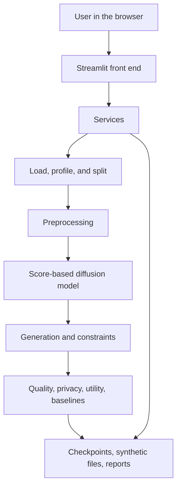
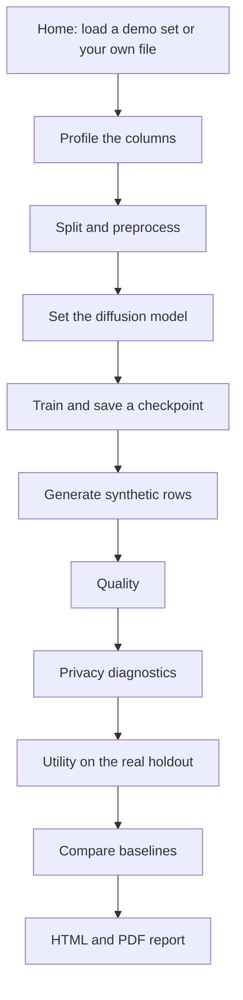
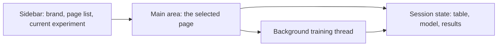

# TabDiffuse

## What is this?

TabDiffuse is a local research application for mixed tabular data. You give it a table, such as a lending or retail sheet. It learns the shape of that table with a score-based diffusion model, draws new rows that follow the same columns, and then measures three things separately:

1. **Quality.** Do the synthetic columns and correlations look like the real table?
2. **Privacy risk.** Do the new rows copy real people, sit unusually close to the training rows, or reveal a sensitive column?
3. **Usefulness.** Can a simple machine-learning model trained on the synthetic rows, or on real rows plus synthetic rows, score well on real rows it has never seen?

The product is for a research workflow, not for publishing a file and calling it anonymous. A privacy label in this app is an empirical diagnostic. It is not differential privacy, k-anonymity, or a promise that a person cannot be recognized.

Everything runs on your machine. An uploaded CSV, Excel, or Parquet file is not sent to an external service. There is no paid API.

Two simulated demonstration tables are included so the flow can be tried without a real customer extract:

| Set | File | What it represents |
|---|---|---|
| A — Lending | `data/raw/demo_set_a_lending.csv` | Customers, loans, and a `loan_status` target |
| B — Retail | `data/raw/demo_set_b_retail.csv` | Orders and a `churn_status` target |

## Technology

The application is one Python 3.12 process. The screen is Streamlit. The learning code is PyTorch. There is no separate React or mobile front end.

| Piece | Role |
|---|---|
| Python 3.12 | Language and local runtime |
| Streamlit | Every screen: sidebar, forms, tables, charts, downloads |
| PyTorch | Score network, training, and sampling |
| pandas, NumPy, PyArrow, openpyxl | Tables: CSV, TSV, Excel, and Parquet |
| scikit-learn, SciPy | Splits, metrics, nearest neighbors, utility models, PCA, t-SNE |
| Plotly, Matplotlib | Charts in the app and figures in the PDF |
| Pydantic, PyYAML | `config.yaml` and typed settings |
| Joblib | Saved preprocessor beside each checkpoint |
| ReportLab | PDF report |
| pytest | Automated tests |

Optional, and not required for a normal run:

| Package | Used for |
|---|---|
| CTGAN | An extra baseline, only if installed and switched on |
| MLflow | Optional experiment tracking |
| UMAP | An extra projection plot |
| SDMetrics | Extra synthetic-data metrics |

Install the required stack with `requirements.txt`. Optional packages live in `requirements-optional.txt`.

## System architecture

The screen never contains the mathematics. Each page calls a service. The service calls the library that loads data, preprocesses it, trains the diffusion model, generates rows, and evaluates them. The same services can run without a browser through `python -m src.demo_pipeline`.



### Layers

| Layer | Folder | What it owns |
|---|---|---|
| Front end | `app.py`, `src/ui/` | Pages, layout, charts, buttons. Session memory for the current run. |
| Services | `src/services/` | Train, resume, generate, evaluate, and store an experiment. |
| Data | `src/data/` | File loading, column profiling, validation, train / validation / holdout split. |
| Preprocessing | `src/preprocessing/` | Turn mixed columns into one continuous vector, and turn a vector back into columns. |
| Diffusion | `src/diffusion/` | Noise schedule, score network, loss, sampler, trainer. |
| Generation | `src/generation/` | Batched sampling, optional conditions, constraint checks. |
| Evaluation | `src/evaluation/` | Statistical similarity, privacy diagnostics, utility probes, simpler generators. |
| Visualization | `src/visualization/` | Plotly figures. Projection plots are qualitative only. |
| Reporting | `src/reporting/` | HTML and PDF filled from the numbers that were actually computed. |
| Configuration | `config.yaml` | Seed, split sizes, network size, demo limits, privacy label cutoffs. |

Identifier columns such as `customer_id` are left out of the model and named in the preprocessing record. The holdout split is never used to fit the preprocessor or the diffusion model.

## Models

TabDiffuse uses one generative model and several smaller models that only score the result. They answer different questions and are not interchangeable.

### 1. The generative model: variance-preserving score network

This is the model that creates synthetic rows.

A mixed table is first converted to a continuous vector. The model then learns the score, which is the gradient of the log-density of that vector as noise is added. The forward process is the variance-preserving stochastic differential equation

\[
dx = -\frac{1}{2}\beta(t)\, x\, dt + \sqrt{\beta(t)}\, dW.
\]

\(\beta(t)\) follows a linear or cosine schedule. Training minimizes weighted denoising score matching,

\[
\mathbb{E}\left\|\sigma_t\, s_\theta(x_t, t) + z\right\|^2.
\]

The network is a residual multilayer perceptron. Time enters through a sinusoidal embedding. An optional condition embedding is used only when you ask the model to condition on a column. The output layer starts at zero so an untrained network does not invent a large score.

Sampling predicts the clean encoded row from the score and keeps that prediction inside the range of the training features. New rows are then decoded back to the original columns. Dates that are not real calendar days are moved onto a real day and counted. Numeric values outside the training minimum and maximum are moved back onto that range and counted.

| Setting | Research default | Demo Mode |
|---|---|---|
| Epochs | 80 | 8 |
| Batch size | 256 | 64 |
| Hidden width | 256 | 128 |
| Depth | 4 residual blocks | 2 residual blocks |
| Diffusion steps | 200 | 40 |
| Device | CPU or CUDA | CPU |

Demo Mode exists so a laptop can finish a first run. A short run can still sit on the edge of the training range. The quality page shows whether the columns actually match, not only whether they fall inside the minimum and maximum.

### 2. Models that only evaluate the synthetic rows

These models are not the generator. They are fixed probes.

| Probe | Algorithms | Question |
|---|---|---|
| Machine-learning utility | Logistic regression or linear regression, random forest, gradient boosting | If we train on real rows, on synthetic rows, or on both, how well do we predict the target on held-out real rows? |
| Attribute disclosure | Random forest | If we train only on synthetic quasi-identifiers, can we predict a sensitive column on real rows better than the majority class? |
| Nearest neighbor | scikit-learn nearest neighbors | Are synthetic rows closer to real rows than real rows are to each other? |

Classification reports accuracy, precision, recall, F1, and ROC-AUC. Regression reports MAE, RMSE, and \(R^2\). The app does not declare a winner.

### 3. Baseline generators

These are simpler ways to invent rows, so TabDiffuse can be compared with something that is not a diffusion model.

| Baseline | What it does |
|---|---|
| Random resampling | Copies training rows. Similarity looks high because the rows are the original people. |
| Gaussian | Independent normal draws for numbers and independent category frequencies |
| Gaussian copula | Keeps dependence through a Gaussian copula |
| CTGAN | A GAN baseline, only when the optional package is installed and enabled |

### 4. Plots that are not models of the data law

PCA and t-SNE, and UMAP if it is installed, compress real and synthetic rows into two dimensions so you can look at them. They are illustrations. They are not quality scores and they are not privacy proofs.

## Project flow

Follow the sidebar from top to bottom. Each stage has a button that opens the next one.



1. **Load.** Home loads demonstration set A or B. Dataset Upload accepts your own CSV, TSV, Excel, or Parquet file.
2. **Profile.** Types, missing values, duplicates, imbalance, and identifier-like columns are recorded. Nothing is deleted.
3. **Preprocess.** Rows are split into training, validation, and holdout. Encoders fit on the training split only.
4. **Configure.** Choose the noise schedule, network size, epochs, and device, or keep Demo Mode.
5. **Train.** A new id such as `EXP-2026-0010` is created. The loss chart uses the real loss from each epoch. Pause, resume, and stop act on that run. Resume continues the same id after you raise the epoch count.
6. **Generate.** Choose how many rows, the sampler, temperature, an optional condition, and optional constraints. CSV and Parquet are written under `data/synthetic/<experiment id>/`.
7. **Quality.** Compare distributions, categories, and correlations with the training split.
8. **Privacy.** Exact copies, nearest-neighbor distance, membership against the holdout, and an optional disclosure probe.
9. **Utility.** Train the probe models on real rows, synthetic rows, and both. Always test on the real holdout.
10. **Baselines.** Score resampling, a Gaussian, and a Gaussian copula on the same split.
11. **Report.** Write HTML and PDF from the stored measurements, plus your research notes.

One experiment id joins the files on disk:

| Path | Contents |
|---|---|
| `artifacts/experiments/<id>/experiment.json` | Configuration, seed, package versions, notes, and metrics |
| `models/checkpoints/<id>/` | Best and latest weights, plus the fitted preprocessor |
| `models/metadata/<id>/` | Preprocessing actions in JSON |
| `data/synthetic/<id>/` | Synthetic CSV and Parquet |
| `data/reports/<id>/` | `report.html` and `report.pdf` |
| `artifacts/logs/tabdiffuse.log` | Events and tracebacks |

## Front end

The front end is the Streamlit app started by `app.py`. Open the local URL it prints, usually `http://localhost:8501`. There is one window: a sidebar for navigation and a main area for the current stage.



The visual style lives in `src/ui/theme.py`. The page is about 1180 pixels wide, with a light sidebar, white metric cards, a teal workflow strip, a warning banner when Demo Mode is on, and a quiet box for privacy disclaimers. Plotly draws the interactive charts. Tables use Streamlit dataframes. Long training does not freeze the page: training runs on a background thread, and the Training page refreshes the loss chart once per epoch.

A page button does not write the sidebar selection directly. It queues the next page, and the app applies that request before the navigation control is drawn. That is how **Continue to profiling** and the other continue buttons change the screen.

### Sidebar

- Brand: TABDIFFUSE, with the line “Synthetic Tabular Data Generation”.
- The page list, top to bottom, in the order of the workflow.
- The current experiment id, once training has created one.
- A Demo Mode note when a demonstration set is loaded.
- A reminder that the table stays on this machine.

### Home

The landing page. Four status cards show whether a dataset is loaded, whether a model is trained, how many synthetic rows are in memory, and whether an evaluation exists. A workflow strip lists Upload, Profile, Preprocess, Train, Generate, Evaluate, and Report. Research notes are typed here: question, hypothesis, dataset description, observations, and conclusion. Those notes are stored with the experiment and copied into the report.

Buttons: **Load demo set A — Lending**, **Load demo set B — Retail**, and, after a table is loaded, **Continue to profiling**.

### Dataset Upload

For your own file. After you choose a file, **Analyze dataset** shows name, size, shape, memory, column types, missing values, duplicate rows, and unique counts. **Continue to profiling** moves on. This page does not train a model.

### Data Profiling

Read-only summary of the current table: detected types, warnings, suggested target, and column roles. Warnings do not drop columns. **Continue to preprocessing** is the next step.

### Preprocessing

**Apply preprocessing** builds the split and the encoders. The page lists what happened to each column: excluded, numeric scaling, one-hot, embedding, or date parts. **Continue to model configuration** comes after a successful fit.

### Model Configuration

Form for the diffusion model: SDE type, linear or cosine noise, diffusion steps, reverse SDE or probability-flow sampler, hidden size, depth, dropout, epochs, batch size, learning rate, weight decay, and device. **Use recommended configuration** picks a smaller network for a small table. A memory estimate is shown so a large setting can be reduced before training. **Continue to training** saves those choices into the session.

### Training

**Start training** creates the experiment and starts the background job. The page shows epoch progress, training loss, validation loss, elapsed time, remaining time, and a live loss chart. **Pause**, **Resume**, and **Stop training** control that job. **Resume from checkpoint** continues the same experiment after the epoch count is increased. **Save checkpoint snapshot** writes the current weights.

### Synthetic Generation

Available after a checkpoint exists. Buttons choose 1,000, 5,000, 10,000, or 50,000 rows, or a custom count, or an augmentation ratio of 10% to 200% of the uploaded table. Sampling steps, temperature, and seed are numeric fields. You can condition on a column, balance its classes, and turn on constraint rules. The example rules in the text box do nothing until **Apply constraints** is checked.

**Generate synthetic data** runs the sampler, restores columns, and writes CSV and Parquet. The page then shows how many rows were kept, how long generation took, how many rows constraints rejected, and how many exact copies of training rows were found. If numbers were moved back onto the training range, or dates were repaired, a caption states the counts. Downloads and **Run evaluation** follow.

### Quality Evaluation

**Run quality evaluation** compares the training split with the synthetic table. You get numeric summaries, distribution distances, category gaps, correlation heatmaps, and optional PCA or t-SNE plots. **Open report page** jumps ahead when you are ready.

### Privacy Evaluation

A disclaimer stays at the top. You may mark quasi-identifiers and one sensitive column. **Run privacy diagnostics** computes exact-match rate, nearest-neighbor ratio, training-versus-holdout membership, and, when those columns are set, the disclosure probe. Each check has a label: Low, Moderate, or Higher observed risk. The labels follow the cutoffs in Settings. The page says that these are not a formal privacy guarantee.

### ML Utility

You pick the target column and classification or regression. **Run utility evaluation** scores the three training setups on the real holdout and draws a grouped bar chart. Empty synthetic columns, such as a date the model could not fill, are dropped for that probe so the other columns can still be scored.

### Experiment Comparison

**Run baseline comparison** builds the resampling, Gaussian, and copula tables and lines them up with TabDiffuse. CTGAN appears only if you enable it and the package is installed.

### Reports

**Generate HTML and PDF report** writes `data/reports/<experiment id>/`. The text is taken from the experiment record: data, preprocessing, model, losses, generation, quality, privacy, utility, baselines, and your notes. Missing measurements stay blank.

### Settings

Numeric cutoffs for the privacy labels. Changing a cutoff changes the label, not the underlying measurement. Confirmed buttons can drop the uploaded table from the session, delete the generated file, or delete the current experiment’s local artifacts. Deletion stays inside this project folder.

## How to start it

From the project folder:

```powershell
cd "d:\QuorentX\College Projects\TABDIFFUSE"
.\.venv\Scripts\activate
streamlit run app.py
```

The same pipeline without the screens:

```powershell
python -m src.demo_pipeline
```

Tests:

```powershell
python -m pytest
```

A deeper process and file-level description is in `docs/ARCHITECTURE_AND_PROCESS.md`.
